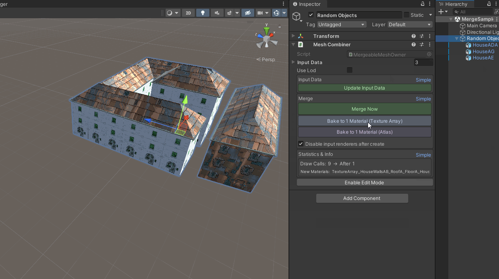

# MeshMerge — Mesh Combiner & Texture Array Baker

**Version:** 1.0.0

**Author:** maleric

---

## Table of Contents

1. [Overview & Features](#1-overview--features)
2. [Quick Start Guide](#2-quick-start-guide)
3. [Shader Setup & Configuration](#3-shader-setup--configuration)
4. [Script Reference (API)](#4-script-reference-api)
5. [Troubleshooting & FAQ](#5-troubleshooting--faq)
6. [Changelog](#6-changelog)

---

## 1. Overview & Features

MeshMerge is a lightweight, free editor extension that optimizes games by merging static meshes and baking their textures into Texture Arrays or Atlases. Zero external dependencies.

### Key Features

- **Mesh Combiner:** Merge child GameObjects into a single mesh, reducing draw calls by 80-90%
- **Texture Array Baking:** One-click material merging using Texture2DArray with UV.z encoding
- **Atlas Baking:** UV-offset packing for non-tiling textures using standard Lit shader
- **Mesh Splitter:** Break multi-submesh meshes back into individual GameObjects
- **Batch Processing:** Process all MeshCombiners in the scene at once
- **Custom URP Shader:** Full ambient lighting (Spherical Harmonics) and shadow support
- **Runtime Support:** Dynamic merging via `RuntimeMergableMeshOwner` (input built in the editor; see Script Reference)
- **Full Undo/Redo:** Unity undo for all operations

### Compatibility

- Unity 2021.3 LTS or later
- Built-in Render Pipeline and Universal Render Pipeline (URP)
- No external dependencies

---

## 2. Quick Start Guide

### Step 1: Create Demo Scene

Open the menu **GameObject > MeshMerge > Create Demo Scene**.

This creates a group of house prefabs ready for optimization. The materials are automatically configured for your active render pipeline (Built-in or URP).

### Step 2: Merge Meshes

1. Select the root object in the Hierarchy
2. In the Inspector, locate the **Merge** section
3. Click **Merge Now**
4. All child meshes combine into one mesh. Input renderers auto-disable.



### Step 3: Bake to 1 Material

Choose one of two baking modes:

| Button | Best For | Result |
|---|---|---|
| **Bake to 1 Material (Texture Array)** | Tiling textures (walls, roofs, floors) | 1 texture array material → 1 draw call |
| **Bake to 1 Material (Atlas)** | Non-tiling textures (UVs in 0-1) | 1 atlas material → 1 draw call |

The tool extracts textures, creates material rules, and merges to a single draw call.

> **Atlas vs Texture Array:** Atlas baking packs textures into one image and works best when every texture is non-tiling (UVs inside 0–1). For tiling textures (walls, roofs, floors), use **Texture Array** baking — each material keeps its own slice so UVs can repeat freely. The tool warns when tiling UVs are detected during atlas baking.

### Step 4: Split (Optional)

1. Right-click a multi-submesh object
2. Choose **MeshMerge > Add Mesh Splitter**
3. Click **Split Now** to separate into individual GameObjects

### Atlas Demo

Open **GameObject > MeshMerge > Create Atlas Demo** to see a 4-cube example with atlas baking.

---

## 3. Shader Setup & Configuration

### maleric/TextureArray/URP (Recommended for URP)

| Property | Description | Default |
|---|---|---|
| **Texture Array** | The Texture2DArray generated by the tool | — |
| **Base Color** | Tint color multiplier | White |
| **Metallic** | Surface reflectivity (0-1) | 0 |
| **Smoothness** | Surface roughness/gloss (0-1) | 0.5 |
| **Occlusion** | Ambient occlusion intensity (0-1) | 1 |

### maleric/TextureArray/Standard (Built-in RP)

| Property | Description | Default |
|---|---|---|
| **Texture Array** | The Texture2DArray generated by the tool | — |
| **Color** | Tint color multiplier | White |
| **Metallic** | Surface reflectivity (0-1) | 0 |
| **Smoothness** | Surface roughness/gloss (0-1) | 0.5 |

### Pipeline Detection

The tool automatically detects your active render pipeline and selects the correct shader. You can also manually override via **Tools > MeshMerge > Settings**.

---

## 4. Script Reference (API)

### MergeableMeshOwner

Runtime component that merges child meshes.

| Method | Description |
|---|---|
| `Create()` | Merges children into a single mesh |
| `CreateToNewGameObject()` | Creates merged mesh on a new child object |
| `UpdateMeshObjectInputData()` | Rescans child meshes for input data |
| `SetEnableInputRenderers(bool)` | Toggle source mesh visibility |

### RuntimeMergableMeshOwner

For dynamic merging at runtime.

| Method | Description |
|---|---|
| `UpdateRuntimeInputData(List<MeshObjectFactoryInputData>)` | Adds new meshes and re-merges on the fly |

### MeshUtilities

Static utility methods.

| Method | Description |
|---|---|
| `MeshUtilities.MergeMeshes(processData)` | Combines meshes with material rules |
| `MeshUtilities.SplitSubmeshes(inputData)` | Splits into individual meshes |
| `MeshUtilities.GetSubmesh(mesh, index)` | Extracts a single submesh preserving vertex data |

### MeshObjectFactoryInputData

Serializable struct describing one input mesh.

| Field | Description |
|---|---|
| `Name` | Display name |
| `Mesh` | Source mesh |
| `Materials` | Material GUIDs |
| `Transform` | Local-to-parent matrix |
| `LodLevel` | LOD level (0, 1, 2) |

### Example: Runtime Merge (Editor)

Material rules are stored by asset GUID, so runtime input data is easiest to build in the editor (GUID resolution requires `AssetDatabase`):

```csharp
using maleric;
using UnityEditor;

public class ExampleRuntimeMerge : MonoBehaviour
{
    [ContextMenu("Add Runtime Input")]
    void AddInput()
    {
        var combiner = gameObject.AddComponent<RuntimeMergableMeshOwner>();
        var mf = GetComponent<MeshFilter>();
        var mr = GetComponent<MeshRenderer>();

        var guids = new string[mr.sharedMaterials.Length];
        for (int i = 0; i < mr.sharedMaterials.Length; i++)
        {
            if (AssetDatabase.TryGetGUIDAndLocalFileIdentifier(mr.sharedMaterials[i], out string g, out long _))
                guids[i] = g;
        }

        var input = new MeshObjectFactoryInputData()
        {
            Name = mf.sharedMesh.name,
            Mesh = mf.sharedMesh,
            Materials = guids,
            Transform = transform.localToWorldMatrix,
            LodLevel = MeshObjectFactoryLodLevel.Level0
        };

        combiner.UpdateRuntimeInputData(
            new System.Collections.Generic.List<MeshObjectFactoryInputData>() { input });
    }
}
```

> In player builds, GUID-based material resolution is not available. For builds, pre-bake the merged result in the editor, or extend the runtime input with direct `Material` references.

---

## 5. Troubleshooting & FAQ

### Q: My combined model looks flat or has pitch black shadows

Ensure your scene has environment lighting. The custom shader uses Spherical Harmonics for ambient light. Open **Window > Rendering > Lighting** and click **Generate Lighting**.

### Q: Which shader should I use?

The tool auto-detects URP vs Built-in RP:
- URP uses `maleric/TextureArray/URP`
- Built-in RP uses `maleric/TextureArray/Standard`

### Q: Does this modify my source FBX files?

No. All operations work on copies. Your original files are never modified.

### Q: Why does my Atlas look wrong with tiling textures?

Atlas baking works best for non-tiling textures (UVs in 0-1 range). For tiling textures (walls, roofs, floors), use **Texture Array** baking instead.

### Q: Can I use this at runtime?

Partially. Add `RuntimeMergableMeshOwner` to a GameObject and call `UpdateRuntimeInputData()` with your mesh data. Input data is built in the editor (material rules use asset GUIDs); for player builds, pre-bake the merged result in the editor or supply direct material references.

### Q: My combined mesh is grainy when zoomed out

This can occur on some GPU/driver combinations due to hardware texture array mipmap handling. It is a known platform limitation.

---

## 6. Changelog

### 1.0.0 (2026-07-11)

- Initial release
- Mesh Combiner, Texture Array Baker, Atlas Baker, Mesh Splitter
- Custom URP shader with ambient lighting and shadows
- Runtime merge support
- Batch processing
- Material rules system
- Demo scenes (House + Atlas)